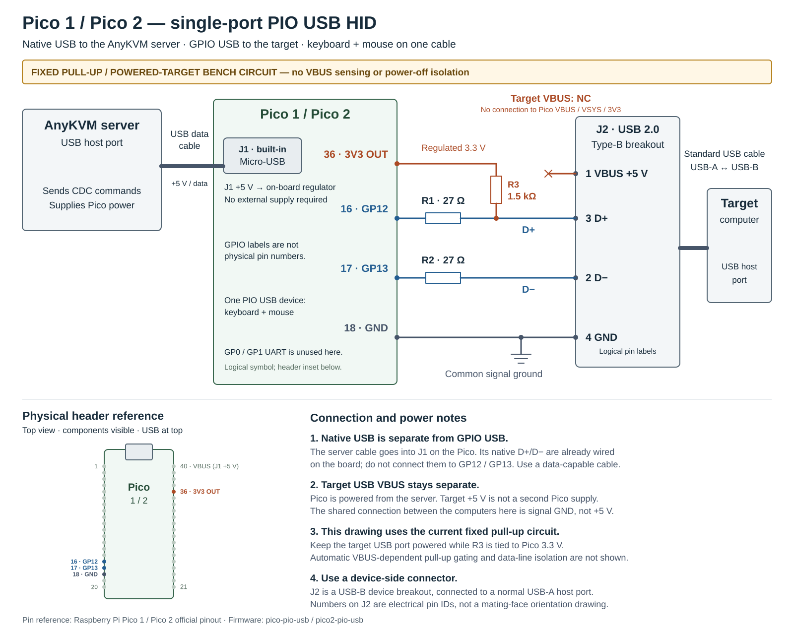

# AnyKVM PIO USB HID — Pico 1 / Pico 2

Native USB CDC or GP0/1 UART receives AnyKVM commands. An external USB device
circuit on GP12 (D+) and GP13 (D-) sends keyboard and absolute/relative mouse
reports to the target. Application source is shared in `../pico-common/`.

Build with `python3 tools/build_firmware.py --targets pico-pio-usb pico2-pio-usb`.
Flash the corresponding `build/firmware/releases/<target>/anykvm-pio-usb.uf2`.

See the [shared wiring and usage guide](../pico-common/README.md), particularly
[external USB circuitry](../pico-common/README.md#external-pio-usb-device-wiring)
and [validation scope](../pico-common/README.md#validation). These generic Pico
images require their own hardware acceptance; the separate Waveshare USB-A board
has different circuitry and its existing validation does not transfer.

## Single-port wiring diagram

[Open SVG](../pico-common/images/pico-pio-usb-wiring.svg). The diagram marks both
GPIO IDs and actual header pin numbers, series resistors, the 3.3 V pull-up,
server power and the separate target USB connection. This fixed-pull-up bench
circuit requires the target USB port to remain powered; it does not include
VBUS detection or power-off isolation.
